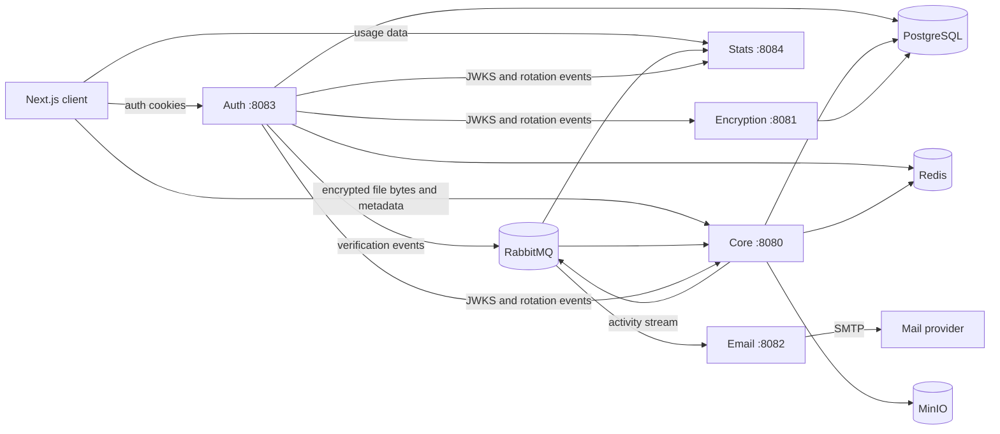

# Encryptify

Encryptify is a self-hosted cloud drive built as a set of Spring Boot services with a Next.js web client. It supports account verification, cookie-based authentication, folders, file upload/download, browser-side file encryption, and per-user usage statistics.

The project is under active development. The repository contains a working application and deployment manifests, but local full-stack setup still assumes familiarity with Kubernetes and the supporting services described below.

## What it does

- Registers users and verifies their email address before sign-in.
- Issues short-lived access tokens and refresh tokens as HTTP-only cookies.
- Signs JWTs with Ed25519 keys, publishes a JWKS endpoint, and rotates signing keys daily.
- Creates, lists, renames, and deletes folders.
- Uploads, downloads, renames, and deletes files stored in MinIO.
- Encrypts file contents in the browser with AES-256-GCM before upload.
- Tracks file count, folder count, storage use, and recent activity through RabbitMQ Streams.
- Provides light and dark themes in a static-exportable Next.js interface.

## Security model

File bytes are encrypted by the web client before they reach the backend. A fresh AES-256-GCM key and 96-bit IV are generated for each upload. MinIO therefore receives the encrypted bytes, while PostgreSQL stores file and folder metadata.

There is an important current limitation: encryption keys are stored in the uploading browser's `localStorage`, and file-to-key mappings are stored in IndexedDB. They are not synchronized or backed up. Clearing site data, changing browsers, or changing devices can make existing files impossible to decrypt. Treat the current implementation as a development-stage client-side encryption design, not as a finished key-management or recovery system.

Passwords are hashed with BCrypt (cost 12). Authentication tokens are kept in HTTP-only cookies; production cookies are secure by default. Protected services validate tokens with public keys fetched from the auth service's JWKS endpoint. The separate encryption service currently stores public-key metadata and is not yet used by the frontend's file-encryption flow.

## Architecture



| Component | Responsibility | Default port |
| --- | --- | ---: |
| `encryptify-frontend` | Next.js/React web interface and browser-side encryption | 3000 in development, 80 in Kubernetes |
| `encryptify-auth` | Registration, login, account state, JWT/JWKS, key rotation | 8083 |
| `encryptify-core` | File/folder metadata and MinIO operations | 8080 |
| `encryptify-email` | Verification email delivery and code validation | 8082 |
| `encryptify-encryption` | Public-key metadata assignment; currently separate from browser encryption | 8081 |
| `encryptify-stats` | Usage totals and recent activity | 8084 |
| `encryptify-auth-lib` | Shared cookie/JWT authentication components | library |

Supporting infrastructure consists of PostgreSQL, Redis, MinIO, RabbitMQ with the stream plugin, Kubernetes, Helm, Argo CD, External Secrets Operator, and cert-manager.

## Repository layout

```text
.
├── encryptify-auth/          Authentication service
├── encryptify-auth-lib/      Shared Spring Security library
├── encryptify-core/          File and folder service
├── encryptify-email/         Email verification service
├── encryptify-encryption/    Public-key metadata service
├── encryptify-frontend/      Next.js frontend
├── encryptify-stats/         Statistics service
├── dockerfiles/              Release image definitions
├── helm/                     App, dependency, ingress, and Argo CD charts
├── setup_k8s_dev             Unix development dependency setup
├── setup_k8s_dev.cmd         Windows equivalent
└── .github/workflows/        Test, image, and chart release workflows
```

## Requirements

For frontend development:

- Node.js 20 or newer
- npm

For backend development:

- JDK 21
- Maven 3.9 or newer
- PostgreSQL
- Redis
- MinIO
- RabbitMQ with the stream plugin enabled and the queues, exchanges, and bindings defined in `helm/Communication/templates/communication-external-secret.yaml`
- SMTP credentials for registration emails

For the repository's deployment workflow:

- A Kubernetes cluster
- Helm 3 and `kubectl`
- Argo CD for GitOps deployment
- External Secrets Operator and the configured `oci-secret-store`
- cert-manager and Traefik for the supplied TLS/Ingress configuration
- Telepresence if cluster dependencies are consumed by locally running services

Backend modules depend on `pl.dayfit:encryptify-auth-lib:0.0.1.7` from GitHub Packages. If Maven cannot resolve it, add credentials with package read access under a server named `github` in `~/.m2/settings.xml`:

```xml
<settings>
  <servers>
    <server>
      <id>github</id>
      <username>YOUR_GITHUB_USERNAME</username>
      <password>YOUR_GITHUB_TOKEN</password>
    </server>
  </servers>
</settings>
```

Do not commit the token or a populated settings file.

## Run the frontend

The frontend can be started independently, although sign-in and drive operations require the backend APIs.

```bash
cd encryptify-frontend
npm ci
npm run dev
```

Open <http://localhost:3000>. In development, the client defaults to these API locations:

```dotenv
NEXT_PUBLIC_AUTH_URL=http://localhost:8083/api/v1/
NEXT_PUBLIC_CORE_URL=http://localhost:8080/api/v1
NEXT_PUBLIC_STATS_URL=http://localhost:8084/api/v1/statistics
```

To override them, create `encryptify-frontend/.env.local`. Keep the trailing slash on `NEXT_PUBLIC_AUTH_URL`. `NEXT_PUBLIC_ENCRYPTION_URL` and `NEXT_PUBLIC_EMAIL_URL` are present in the example configuration but are not currently called by the frontend.

Create a production static export with:

```bash
npm run build
```

The result is written to `encryptify-frontend/out` and is served by Nginx in the frontend container. Note that the tracked `.env.production` points at `https://encryptify.dayfit.pl`; override those public variables when building for another host.

## Run the full stack for development

There is no Docker Compose configuration. The included development path runs PostgreSQL, Redis, MinIO, and RabbitMQ in Kubernetes, then runs the Spring services and frontend locally.

1. Copy the environment template and fill every value required by the services you intend to run:

   ```bash
   cp .env.example .env
   ```

   For a local frontend, set `ALLOWED_ORIGINS_PATTERNS=http://localhost:3000`. `JWKS_URI` should resolve to the auth service's `/.well-known/jwks.json` endpoint. Never commit `.env`.

2. Prepare a Kubernetes cluster with External Secrets Operator and the `oci-secret-store` expected by the charts. Build the chart dependencies:

   ```bash
   helm dependency build helm/Data
   helm dependency build helm/Communication
   ```

3. Install the development dependencies:

   ```bash
   ./setup_k8s_dev
   ```

   On Windows, run `setup_k8s_dev.cmd`. These scripts target an already prepared cluster; they do not install Kubernetes, External Secrets Operator, or the OCI secret store.

4. Make cluster services reachable from the host. For Minikube, the repository suggests:

   ```bash
   telepresence connect --context=minikube
   ```

5. Export the backend environment in each service terminal, then start the services with the `dev` profile. Start auth first so the other protected services can synchronize JWKS data.

   ```bash
   set -a
   source .env
   set +a
   cd encryptify-auth
   mvn spring-boot:run -Dspring-boot.run.profiles=dev
   ```

   Repeat the final two commands for `encryptify-core`, `encryptify-email`, `encryptify-encryption`, and `encryptify-stats`. The `dev` profile uses destructive `create-drop` schema management in the database-backed modules, so use a disposable development database.

6. Start the frontend as shown in [Run the frontend](#run-the-frontend).

Account registration requires the email service, working SMTP settings, and RabbitMQ topology. File operations additionally require Core and MinIO. The dashboard statistics require the Stats service and RabbitMQ Streams.

## Useful API routes

The browser normally calls these routes; this is a short orientation, not a full API specification.

| Method | Route | Purpose |
| --- | --- | --- |
| `POST` | `/api/v1/auth/register` | Create an account and send verification email |
| `POST` | `/api/v1/auth/login` | Set access and refresh cookies |
| `POST` | `/api/v1/auth/refresh` | Refresh the access cookie |
| `POST` | `/api/v1/auth/logout` | Clear authentication cookies |
| `GET` | `/.well-known/jwks.json` | Return current JWT verification keys |
| `GET` | `/api/v1/email/verify?code=...` | Verify an email address |
| `GET` | `/api/v1/folder/get-content` | List root or folder content |
| `POST` | `/api/v1/folder/create` | Create a folder |
| `PATCH` | `/api/v1/folder/rename` | Rename a folder |
| `DELETE` | `/api/v1/folder/delete` | Delete a folder |
| `POST` | `/api/v1/file/upload` | Upload multipart metadata and encrypted bytes |
| `GET` | `/api/v1/file/download?fileId=...` | Download encrypted bytes |
| `PATCH` | `/api/v1/file/rename` | Rename a file |
| `DELETE` | `/api/v1/file/delete` | Delete a file |
| `GET` | `/api/v1/statistics/get` | Get the authenticated user's statistics |

Authenticated requests use the `accessToken` and `refreshToken` cookies rather than an `Authorization` header.

## Build and verify

Run a backend module's checks from its directory:

```bash
cd encryptify-core
mvn test
```

Run the frontend production build from its directory:

```bash
cd encryptify-frontend
npm run build
```

The pull-request workflow runs `mvn test` for the five services. Release workflows build multi-architecture images in GHCR and copy versioned Helm charts to the separate deployment repository consumed by Argo CD.

## Kubernetes deployment

Application charts are under `helm/Encryptify-*`; shared data, messaging, ingress, certificate, and Argo CD resources have separate charts. The supplied production configuration is specific to `encryptify.dayfit.pl`, OCI-backed external secrets, Traefik, and the `Day-fit/Encryptify-CD` repository. Forks should update those values and templates before deployment.

`deploy-app-of-apps.sh` creates the root Argo CD application after Argo CD itself has been installed:

```bash
./deploy-app-of-apps.sh
```

Review this script before running it: the application uses automated synchronization, pruning, and self-healing against the configured CD repository.

## FAQ

### Is it end-to-end encrypted or zero-knowledge?

File contents are encrypted and decrypted in the browser, so the backend stores encrypted file bytes. However, key storage is currently browser-local and the broader design has not been independently audited. The repository therefore avoids making a blanket zero-knowledge or production security claim.

### Where are encryption keys stored?

Raw per-file AES keys are stored in browser `localStorage`; IndexedDB maps backend file IDs to those keys. They are not stored in MinIO or sent with the file content.

### Can I download my files from another browser or device?

Not with the current key-management implementation. The other browser will not have the required local key. Export, synchronization, and recovery are not implemented.

### What happens if I clear browser storage?

The client loses its encryption keys and mappings. Files already uploaded remain in MinIO but cannot be decrypted by that browser.

### Why are both an encryption service and browser encryption present?

They represent separate parts of an unfinished design. The browser performs the current AES-GCM file encryption. The encryption service exposes public-key metadata assignment, but the frontend does not currently call it.

### Why does registration require RabbitMQ and email configuration?

Auth publishes a registration event, the email service sends a verification link, and successful verification publishes setup events for the user's MinIO bucket and statistics record. Those asynchronous steps require the expected RabbitMQ topology.

### Why does the frontend appear logged out when an API is running?

Check that the auth URL ends at `/api/v1/`, cookies are being accepted, and `ALLOWED_ORIGINS_PATTERNS` includes the exact frontend origin. Local development uses non-secure cookies through the auth `dev` profile; production cookies require HTTPS.

### Why can Maven not resolve `encryptify-auth-lib`?

The services consume version `0.0.1.7` from GitHub Packages. Configure a `github` Maven server with a GitHub token that has package read access, as shown in [Requirements](#requirements).

### Why does a local production build call the hosted API?

Next.js loads `encryptify-frontend/.env.production` during `npm run build`, and that file points to `encryptify.dayfit.pl`. Supply your own `NEXT_PUBLIC_*` values when building for another environment.

### Can I start everything with one command?

No. The setup scripts provision only the Kubernetes-hosted data and messaging dependencies in a cluster that already has the required secret infrastructure. Backend services and the frontend are then started separately for local development.

### Is there an OpenAPI/Swagger page?

No. Springdoc/OpenAPI is not configured. The route table above is intended only as a compact guide to the controller surface.

## License

Encryptify is licensed under the [Apache License 2.0](LICENSE).
